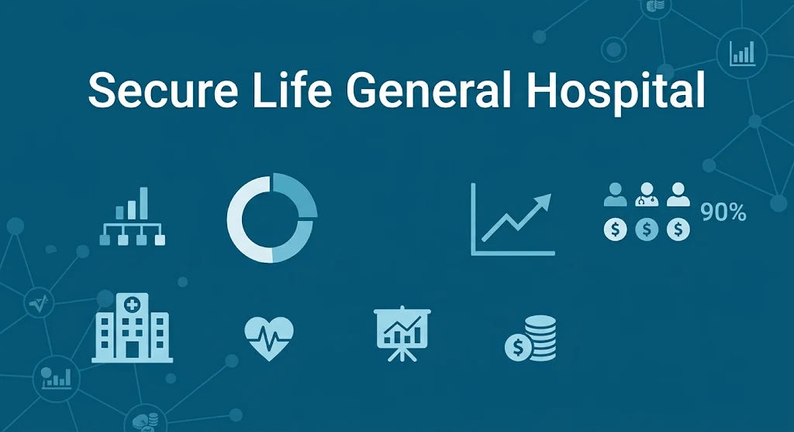
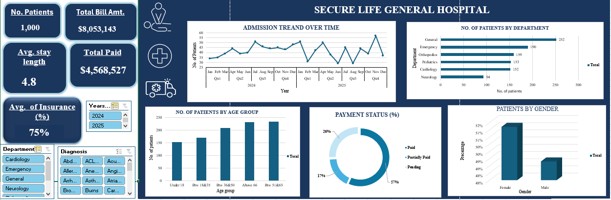

# Secure Life General Hospital: Operational & Financial Performance Dashboard

 ## Project Overview
 

This repository features my very first data analytics project, completed as part of the Data Analysis Track at FadaQa, where I am currently studying on a full scholarship.

As part of my learning journey, this project provided a hands-on opportunity to apply data transformation, data modeling, and visualization techniques to a realistic real-world scenario. The goal was to take raw hospital administrative data and turn it into a clear, actionable, and interactive executive dashboard to support operational decision-making.

# Problem Statement

The leadership team at Secure Life General Hospital observed fluctuating patient admission rates, growing outstanding medical balances, and variance in insurance coverage across departments. However, management lacked a consolidated reporting system to evaluate overall operational and financial health.

As a Data Analyst, I was tasked with building an interactive report to help management answer key operational questions:

- Which departments drive the highest patient volumes and total billings?

- What is the financial gap between total billed revenue and collected/outstanding payments?

- How does insurance coverage vary across different diagnoses and departments?

- What are the demographic trends and average length-of-stay patterns across patient visits?
  ##  Dataset Description

The dataset used in this project contains record-level patient visit data from Secure Life General Hospital. Each row represents a single patient visit (a patient may appear multiple times for separate visits).

- Patient ID: Unique identifier for each hospital visit record.

- Patient Name: Full name of the patient.

- Age: Age of the patient in years at the time of visit.

- Gender: Recorded gender of the patient.

- Admission Date & Discharge Date: Entry and exit timestamps for calculating length of stay.

- Department: Hospital department where treatment was administered (e.g., Cardiology, Emergency, Orthopedics, General, Pediatrics, Neurology).

- Diagnosis: Specific medical condition diagnosed during the visit.

- Total Bill Amount: Gross amount billed by the hospital for services rendered.

- Insurance Coverage (%): Percentage of the total bill covered by insurance.

- Payment Status: Current status of the patient bill (Paid, Pending, or Partially Paid).

**Dataset File** : [Click here](https://1drv.ms/x/c/7c8c23ff56d12e61/IQBg-Vtp1FdWQIAIIcEpIV9OAWIedHdl-5VvKF-uL_DlTi0?e=qtFXVE)

## Tools & Technologies Used

-Microsoft Excel: Data cleaning, structure validation, and aggregate metrics modeling.

-Pivot Tables & Pivot Charts: Dynamic grouping, categorical summarization, and distribution analysis.

-Excel Slicers & Timelines: Interactive UI elements allowing cross-filtering by Department, Diagnosis, and Year.

## Dashboard Preview

## Key Insights
**1. Departmental Workload**
  - The General (252 visits) and Emergency (190 visits) departments record the highest patient traffic, accounting for a significant portion of total hospital visits.
  - Specialty departments like Neurology (94 visits) recorded lower overall volumes.

**2. Financial Breakdown**
  - Out of $8,053,143 in total billed revenue, $4,568,527 has been successfully collected.
  - 57% of patient bills are fully paid, 26% remain completely pending, and 17% are partially paid, highlighting a key area for cash flow optimization.

    
**3. Demographics & Length of Stay**
  - Patients spend an average of 4.8 days in the hospital per visit.
  - Adults aged 36 and above make up the largest proportion of hospital admissions.
  - Gender distribution is fairly balanced, with female patients comprising 52% and male patients 48%.
    
**4. Insurance Coverage**
 - The overall average insurance coverage rate is 75%, though coverage levels fluctuate across specialized treatments and diagnoses.

## Recommendations for Further Analysis

- Predictive Length-of-Stay (LOS) Modeling: Perform regression analysis to identify specific diagnoses or age demographics that correlate with extended stays (>7 days) to optimize bed occupancy modeling.
- Cohort Analysis on Readmission Rates: Track unique Patient ID instances across multiple visits to analyze hospital readmission rates within 30/60/90 days and isolate recurring medical conditions.
- In-Depth Financial Aging & Risk Analysis: Perform an aging analysis on unpaid balances ($26\%$ pending) mapped against specific insurance providers or diagnosis categories to identify root causes of payment delays.
- Time Series Forecasting: Build a time-series forecasting model (e.g., in Python or Power BI) to project seasonal patient admission surges for the Emergency and General departments.
  

